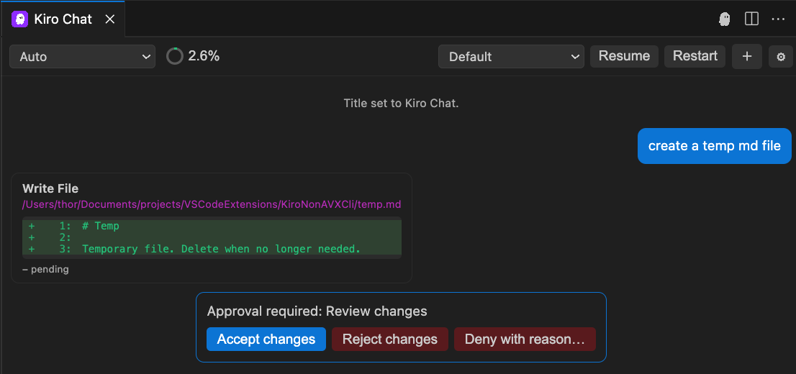
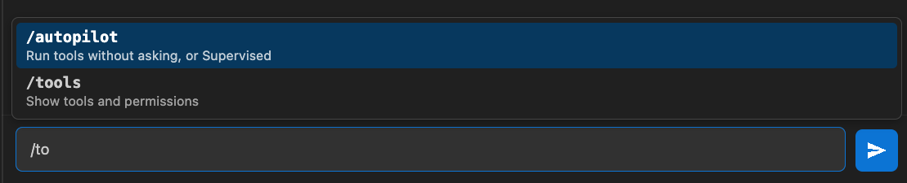
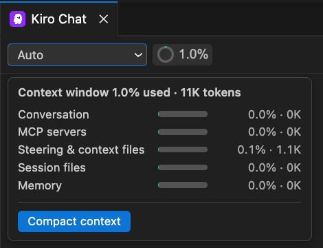
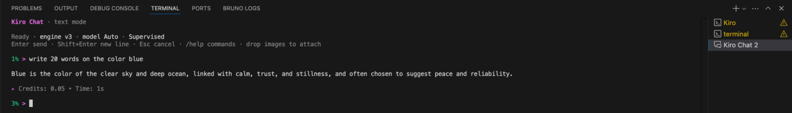
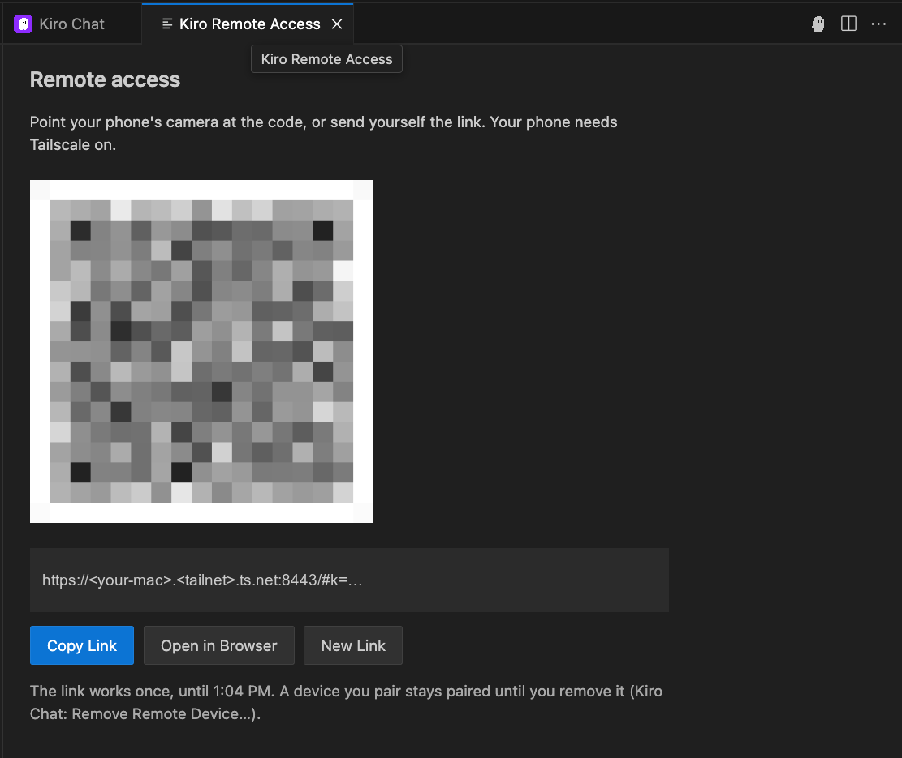

# Kiro Chat

Chat with the Kiro agent inside VS Code, and carry on from your phone.

- **Several chats at once.** Editor tabs, a side bar view and terminal chats,
  each with its own conversation. They reopen after a reload, and Resume brings
  back earlier sessions.
- **You stay in control.** In Supervised mode every file change and command
  waits for your answer: allow, deny (with a reason) or create an allow or deny
  rule. Autopilot is one switch away.
- **Slash commands.** `/usage`, `/context`, `/model`, `/compact`, `/agent`,
  `/mcp` and the rest of kiro-cli's commands work in chat tabs and terminal
  chats. Type `/` for a picker.
- **Remote control.** Turn on remote access, scan a QR code, and watch, prompt,
  stop and approve your chats from a phone or any browser on your tailnet. It
  goes over [Tailscale](https://tailscale.com), is off by default, and nothing
  is hosted anywhere else.
- **Runs on Macs without AVX.** kiro-cli's own terminal UI crashes there; this
  extension doesn't use it. Windows 11 is supported on a best-effort basis.

It needs the Kiro CLI (`kiro-cli`) installed and logged in. See Requirements.

## Quick start

1. Install the [Kiro CLI](https://kiro.dev) and run `kiro-cli login`.
2. Press `Cmd+Alt+K` (`Ctrl+Alt+K` on Windows), or click the Kiro Chat button
   at the top right of the editor.
3. Type a prompt and press Enter. Approve or deny the agent's changes as they
   come.

## Guides

- [Getting started](docs/guide/getting-started.md)
- [Chat tabs and the side bar chat](docs/guide/chat-tabs.md)
- [Terminal chat](docs/guide/terminal-chat.md)
- [Slash commands](docs/guide/slash-commands.md)
- [Remote access from your phone](docs/guide/remote-access.md)
- [Commands and settings](docs/guide/reference.md)
- [Troubleshooting](docs/guide/troubleshooting.md)

## Screenshots

| | |
| --- | --- |
|  |  |
|  |  |

## How it works

Kiro Chat starts the agent engine with `kiro-cli acp` and talks to it over the
Agent Client Protocol (ACP, JSON-RPC over stdio), then draws its own chat UI in
VS Code. kiro-cli's own terminal UI is never launched, so it also runs on Macs
without AVX/AVX2 (for example older Intel Macs running macOS through OpenCore
Legacy Patcher), where that UI crashes.

The extension is built for the **v3 engine** (the Kiro Agent Server). Model and
mode switching, approvals, context breakdown, compaction, checkpoints and most
slash commands use v3-only ACP methods.

## Requirements

- macOS, or Windows 11 (PowerShell). Built and tested on an Intel Mac without
  AVX. **Windows support is new and untested on a real Windows machine**: the
  automated tests run on Windows in CI, but nobody has used the chat there yet.
  If something fails on Windows, please open an issue with the Output → Kiro
  Chat log. Linux isn't supported.
- `kiro-cli` with the v3 engine, installed and on PATH (or set
  `kiroChat.kiroCliPath`). Tested with kiro-cli 2.35.2.
- Logged in (`kiro-cli login`). The chat checks at startup and offers a login
  button if you aren't.
- VS Code 1.98 or later.
- For remote access only: [Tailscale](https://tailscale.com), free for personal
  use, installed and logged in on this computer and on the phone, in the same
  tailnet, with HTTPS Certificates turned on. See
  [Remote access](docs/guide/remote-access.md). The chat works without it.

## Privacy

Your prompts, attached images and the files the agent reads are sent to Kiro
by kiro-cli, as when you use kiro-cli directly. Kiro's own content-collection
setting is in ⚙ Settings. This extension adds no telemetry and makes no
network requests of its own.

## Contributing

See [CONTRIBUTING.md](CONTRIBUTING.md) for building, testing and releasing,
[docs/ARCHITECTURE.md](docs/ARCHITECTURE.md) for how it works, and
[TEST.md](TEST.md) for the manual test checklist.

## License

MIT
