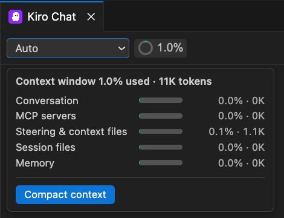
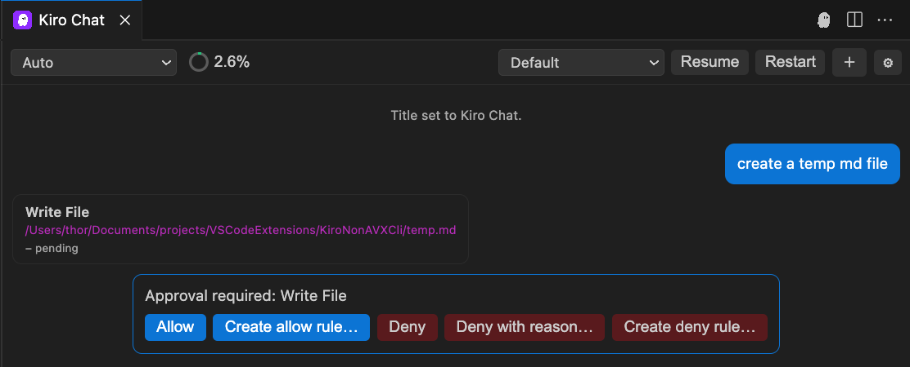
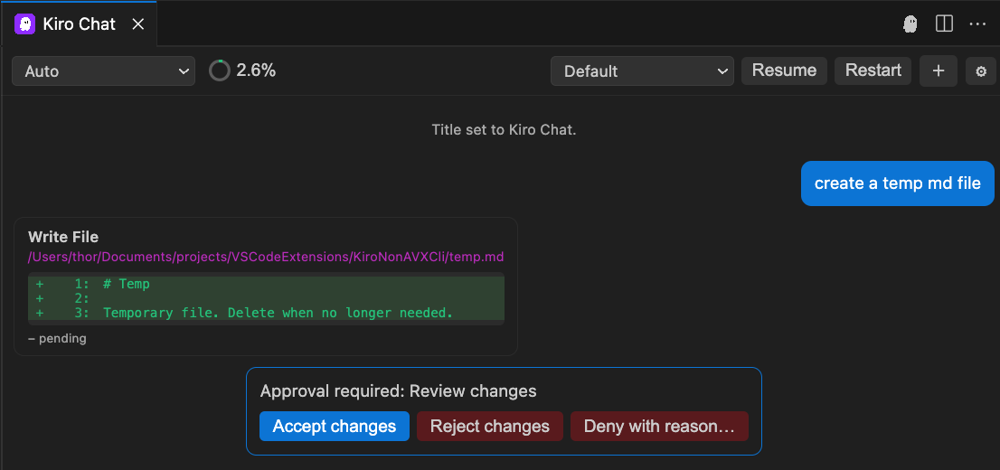
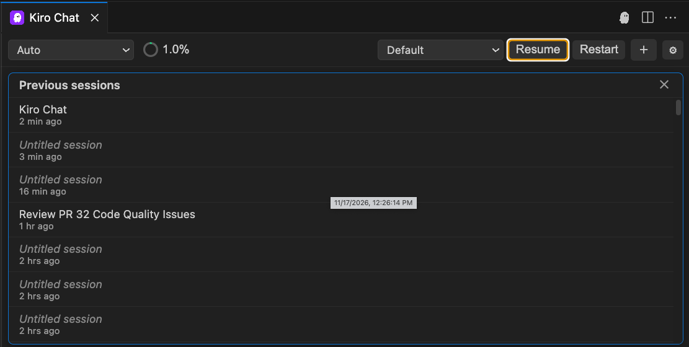
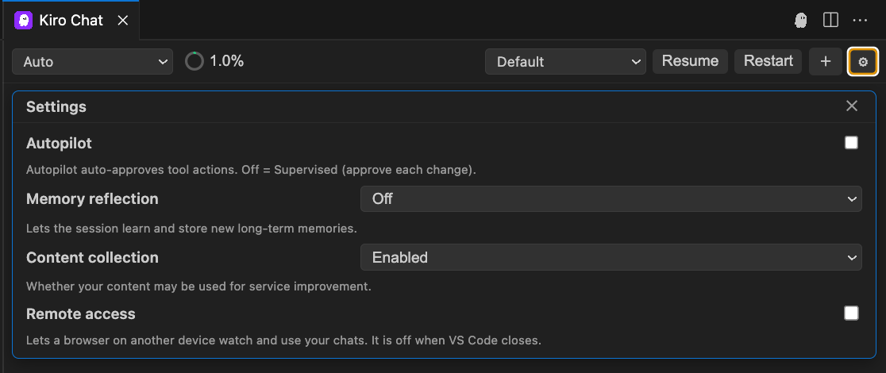

# Chat tabs and the side bar chat

[Guide index](README.md) · [Getting started](getting-started.md) · [Chat tabs](chat-tabs.md) · [Terminal chat](terminal-chat.md) · [Slash commands](slash-commands.md) · [Remote access](remote-access.md) · [Reference](reference.md) · [Troubleshooting](troubleshooting.md)

`Cmd+Alt+K` (`Ctrl+Alt+K` elsewhere), the **Kiro Chat** status-bar item, or **Kiro Chat:
Open Chat** opens the chat as an editor tab (set `kiroChat.openIn` to
`panel` to use the side bar instead). The **Kiro Chat** ghost button at the top right of the editor does the same as
Open Chat. The **Kiro Chat** icon in the Activity Bar
(the left edge) always opens the side bar chat. Drag its icon or its view
elsewhere (for example into the bottom panel) if you prefer.

- **Multiple chats.** Each tab is its own conversation with its own engine.
  Open another with the **＋** button in the toolbar or **Kiro Chat: New
  Chat Tab**. The side bar chat view is a separate conversation too.
- **Survives reloads.** After a window reload, every tab and the side bar view
  reopen the session they had, with the history shown again.
- **Toolbar.** Model dropdown (switches live), context ring with the percentage
  used, Mode dropdown (Default, Plan, …), Resume, Restart, ＋ and ⚙ Settings.

- **Context breakdown.** Hover (or focus) the context ring to see tokens and
  percent for the conversation, MCP servers, steering/context files, session
  files and memory, plus credits used. **Compact context** summarizes the
  conversation to free space.
- **Replies** stream as markdown (headings, lists, tables, code blocks with a
  Copy button). Tool calls show as cards with the files touched, `+`/`-` diffs
  and how long they took.
- **Approvals.**  In Supervised mode (Autopilot off) file changes and commands
  wait for your answer, with the same choices as kiro-cli: **Allow**,
  **Create allow rule…**, **Deny**, **Deny with reason…** (the agent is told
  why) and **Create deny rule…**. A rule covers this exact file or
  command, the command pattern (`find *`), a folder and everything under it
  (file changes; you can edit the folder), or the entire tool (every
  command, every file read, …). Rules last for the session. A line like
  `a; b && c` is asked one command at a time, and the card says which.
- **Images.** Paste a screenshot (`Cmd+V`), Shift-drag image files onto the
  chat, or use **Kiro Chat: Attach Image or File**. Dropping other files
  inserts their paths.
- **Questions.** When the agent asks you something (it does in Spec mode),
  a card shows the choices. Pick one, or type your own answer. A choice
  can open a checklist first. Skip tells the agent to move on.
- **Files in a prompt.** Type `@file:path` (relative to the folder, absolute
  or `~/…`) and the file's text goes to the agent with your prompt. The chat
  keeps showing what you typed. Files must be plain text, up to 256 KB each
  (1 MB per prompt); anything else is left as typed. The chat says which files
  were attached and which were not. Any path you type is read, also outside the
  folder (as kiro-cli does), so check pasted text before you send it.
- **Typing while the agent works.** Enter sends your message to the agent
  right away. It reads it at its next step (after a running tool call, not in
  the middle of one), and a line under your message says when. Images and `/`
  commands wait until the reply is done.
- **Stopping a reply.** While the agent works, a **Stop** button appears next
  to Send; Esc in the message box does the same. The reply ends with
  "■ Cancelled" and any approval it was waiting on is dropped. The chat is
  ready for your next message.
- **Editor context (optional).** With `kiroChat.shareEditorContext` on, the
  agent is told which files are open in VS Code and which is active (paths
  only, inside the chat's folder). It is sent with a prompt when it changed,
  and the chat says so. Works in both chats.
- **Input.** One line that grows as you type. Enter sends, Shift+Enter adds a
  line. Type `/` for a picker of commands, agents and skills.
- **Slash commands.** The terminal chat's commands work in a chat tab too
  (`/usage`, `/context`, `/tools`, `/model`, `/agent`, `/compact`, `/mcp`,
  `/knowledge`, `/config`, `/stats`, `/transcript`, …; `/help` lists them).
  Their output shows in a card under the command, only in this tab (it isn't
  kept after a reload). `/clear` and `/new` start a new conversation,
  `/resume` opens the Resume panel. `/paste`, `/editor`, `/reply`, `/rewind`,
  `/spawn`, `/cls` and `/quit` are for the terminal chat and say what to do
  instead. The agent's own commands (agents, skills, saved prompts) still go to
  the agent, and so does a line that starts with a space. Unknown commands
  aren't sent. The same commands work from a remote device (see Remote
  access).
- **Renaming a chat.** `/title <name>`, **Rename Chat…** on the tab's
  right-click menu or **Kiro Chat: Rename Chat…** renames the chat: its
  tab (or the side bar view), the list on a remote
  device and the session in Resume. The name stays after a reload. `/title`
  shows the name, and `/title clear` (or an empty name in Rename Chat) gives
  the chat its own name back ("Kiro Chat 2"), so a chat can't be named
  `clear`. Resume keeps the last name after a reset. The right-click item
  shows on other webview tabs too (VS Code can't limit it to chat tabs);
  there it only says so.
- **Resume** lists previous sessions for this folder (title, age, message
  count). **Restart** asks before restarting the engine and clearing the chat.
  Clicking outside the Resume or Settings panel (or Esc) closes it.
- **Settings (⚙):** Effort, Autopilot, memory reflection and content
  collection, applied to the live session.

## Approvals

In Supervised mode, a file change or a command shows a card and waits:

A file write is then shown as a diff with **Accept changes**, **Reject
changes** and **Deny with reason…**:

## Resume and Settings

**Resume** lists earlier sessions for this folder:

**⚙ Settings** changes the live session:

