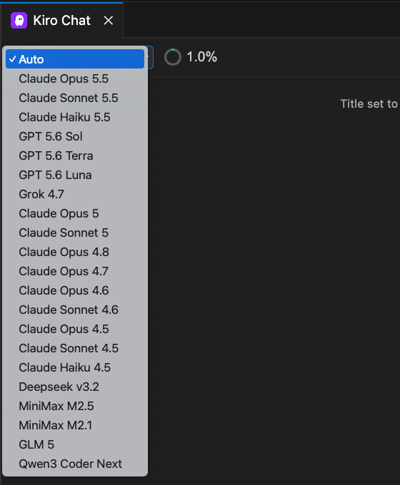
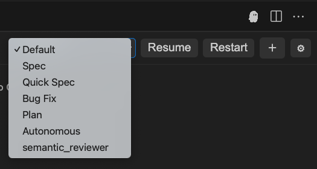

# Getting started

[Guide index](README.md) · [Getting started](getting-started.md) · [Chat tabs](chat-tabs.md) · [Terminal chat](terminal-chat.md) · [Slash commands](slash-commands.md) · [Remote access](remote-access.md) · [Reference](reference.md) · [Troubleshooting](troubleshooting.md)

## 1. Install and log in to kiro-cli

Kiro Chat runs the Kiro CLI's agent engine, so `kiro-cli` must be installed
and logged in first.

1. Install the Kiro CLI from [kiro.dev](https://kiro.dev). On Windows, use its
   PowerShell installer.
2. In a terminal, run `kiro-cli login` and finish the login in the browser.
3. Check it: `kiro-cli whoami` prints your account.

If `kiro-cli` isn't on your PATH (`which kiro-cli`, or `where kiro-cli` in
PowerShell, finds nothing), set `kiroChat.kiroCliPath` in your user settings
to the program's full path.

## 2. Install the extension

Install **Kiro CLI Chat** (id `SepiaGroup.kiro-cli-chat`) from the Extensions
view (search for "Kiro CLI Chat"), or
from a `.vsix` file with **Extensions: Install from VSIX…**.

## 3. Open a chat

Any of these opens a chat:

- `Cmd+Alt+K` (`Ctrl+Alt+K` on Windows).
- The **Kiro Chat** button at the top right of the editor.
- The **Kiro Chat** icon in the Activity Bar (the left edge), which opens the
  side bar chat.
- The **Kiro Chat** item in the status bar.
- **Kiro Chat: Open Chat** in the Command Palette.

The chat checks your login and starts the engine. That takes a few seconds the
first time. If you aren't logged in, it shows a **Log in** button that runs
`kiro-cli login` in a terminal; finish there and click **Retry**.

## 4. Send a prompt

Type in the box at the bottom and press Enter (Shift+Enter adds a line). The
toolbar above the chat has:

- **Model** (left): the model for this chat. It switches at once.
- **Context ring**: how much of the context window is used. Hover it for the
  breakdown.
- **Mode**: Default, Spec, Plan and the other agents you have.
- **Resume**, **Restart**, **＋** (new chat tab) and **⚙** (settings).

## 5. Approve the agent's changes

New chats start in **Supervised** mode: every file change and command waits
for your answer. See [Approvals](chat-tabs.md#approvals). Turn on **Autopilot**
in ⚙ Settings if you want tools to run without asking.

## Next

- [Chat tabs](chat-tabs.md): everything in the chat tab and side bar chat.
- [Terminal chat](terminal-chat.md): a text-only chat in the Terminal panel.
- [Remote access](remote-access.md): use your chats from your phone. This
  needs [Tailscale](https://tailscale.com) on this computer and on the phone;
  nothing else in the extension does.
