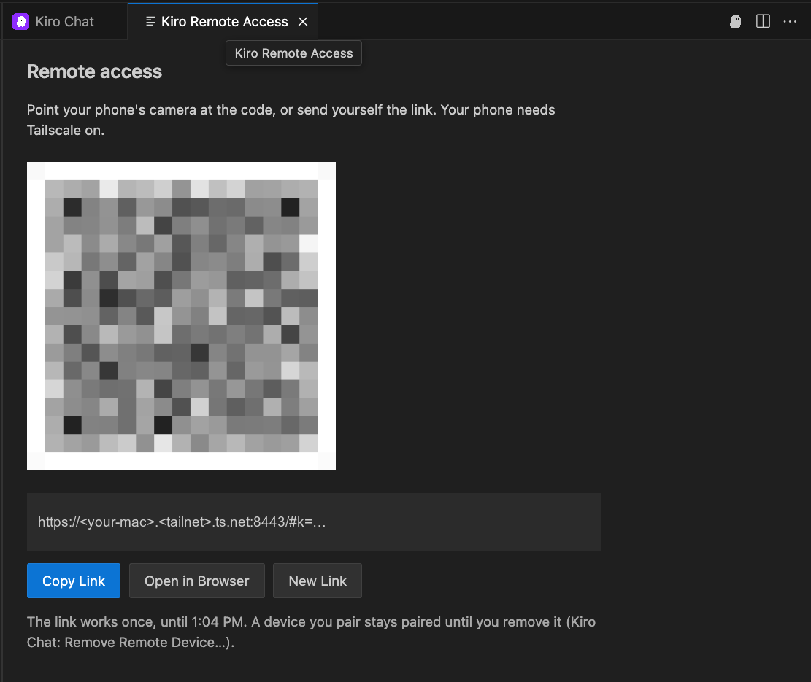

# Remote access (preview)

[Guide index](README.md) · [Getting started](getting-started.md) · [Chat tabs](chat-tabs.md) · [Terminal chat](terminal-chat.md) · [Slash commands](slash-commands.md) · [Remote access](remote-access.md) · [Reference](reference.md) · [Troubleshooting](troubleshooting.md)

Watch and use a chat tab from your phone (or any browser on your tailnet)
while it keeps running on this Mac. The traffic goes over [Tailscale](https://tailscale.com),
so only your own devices can reach it, and nothing is hosted anywhere else.

One-time setup:

1. Install Tailscale on the Mac and the phone and log in to the same tailnet.
2. In the Tailscale admin console, turn on **HTTPS Certificates** (DNS page).
   The first time you start remote access, Tailscale may also give a link to
   switch on Serve; the extension shows it with an **Open Tailscale Setup**
   button.

Then:

1. Tick **Remote access** in ⚙ Settings, run **Kiro Chat: Start Remote
   Access**, or type `/remote` in a terminal chat (`/remote link` for a new
   pairing card, `/remote stop` or `/remote off` to turn it off). A **Remote** item appears in the status bar.
2. A card opens with a QR code. Scan it with the phone's camera, or choose
   **Copy Link** (and send it, for example with AirDrop or Messages) or **Open
   in Browser**. **New Link** makes a fresh code. The pairing link works once,
   for 10 minutes, and the page removes the secret from the address bar. The
   card closes when a device pairs.
3. Pick a chat. You see the conversation as it is here, and can send prompts,
   steer, stop a reply, answer questions, approve (with the same choices as
   here, rules included) and run `/` commands.
   Both screens stay in step: answer an approval on one and it goes away on the
   other, with a line saying who answered.

The address looks like `https://<your-mac>.<tailnet>.ts.net:8443/`. Next time,
open it (or the home screen icon) with Tailscale on: no new link. If Tailscale
is missing or not ready, remote access still starts for this Mac only
(`http://127.0.0.1`) and says what to fix.

**Several VS Code windows.** Turn remote access on in each window you want on
the phone. They share one address, one pairing and one list: the page shows the
chats of every window ("MyRepo: Chat 1"), and the dropdown at the left of the
toolbar shows which chat you are on and switches between them. One window (the first) holds the address;
if it closes or you stop remote access in it, another window takes over within a
few seconds and the page reconnects by itself. **Show Remote Access Link** and
**Remove Remote Device…** work from any of the windows. A window where remote
access is off is not shown.

A paired device stays paired until you remove it (**Remove Remote Device…**).
Remote access is off by default and when VS Code closes (the extension takes its
Tailscale share down; nothing else of yours in `tailscale serve` is touched).
A paired device is trusted like you at the keyboard: for a chat tab it can
create allow or deny rules, switch Autopilot on, restart the engine, resume a
session, open a tab and run `/` commands (`/usage`, `/context`, `/compact`,
`/tools trust-all`, …; their output shows on the phone and in the tab). If a
device is lost, remove it (**Remove Remote Device…**) or take it out of your
tailnet. **If you paired a device before this version, it can now do all of
this.** To keep a device from answering approvals at all, take `approve` out of
`kiroChat.remote.permissions`. There is no setting for "Allow once and
Deny only".

What would act on the Mac itself is left out, and the command says so:
logging in, `/remote`, `/copy`, `/settings`, `/theme`, `/transcript`,
`/chat save`, `/agent create` and `/agent edit` (they open an editor, a
terminal or a file there), and `/context add` and `/knowledge add|update`
(they read a path on the Mac). `/set` changes only the Settings panel's
options. Restart asks on the phone, not in a dialog on the Mac. Of the
`kiroChat.remote.permissions`, `prompt` covers commands, Restart, Resume and
new tabs, and `approve` covers the approval buttons and everything that
changes approvals or Autopilot: the switch, `/autopilot`, `/tools trust-all`,
`/tools reset` and `/set autopilot`. The page fits a phone (light or dark
by the device's setting, large buttons, Enter adds a line and the Send button
sends) and can be added to the home screen. The settings below are machine
settings, so a workspace cannot turn remote access on.

**Terminal chats** are listed too ("Kiro Chat (terminal)"), and work the same
way: the page shows the conversation, and a prompt, Stop, an approval or an
answer from the phone acts in the terminal, which says so ("(from iPhone)",
"Allowed from iPhone"). A prompt from the phone goes to the agent as typed: it
never runs a terminal `/` command, and the phone offers only the agent's own
commands there. An approval from the phone has every choice the terminal has
(allow, deny, with a reason, allow and deny rules, folders), and the terminal
says what was chosen. Only Effort and Model can be changed. While a command
runs in the terminal (`/compact`, `/resume`, …) the phone is asked to try
again. The page shows the terminal's conversation since the terminal opened (or
since `/clear`, `/new` or `/resume`); after `/rewind` it says the later
messages are no longer part of it.
