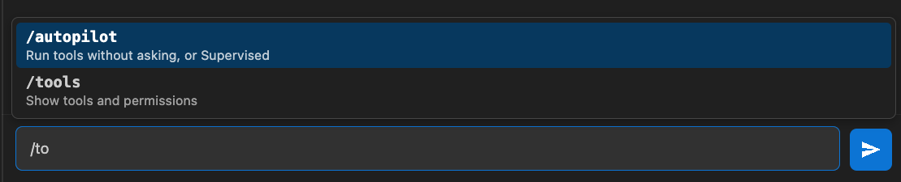

# Slash commands

[Guide index](README.md) · [Getting started](getting-started.md) · [Chat tabs](chat-tabs.md) · [Terminal chat](terminal-chat.md) · [Slash commands](slash-commands.md) · [Remote access](remote-access.md) · [Reference](reference.md) · [Troubleshooting](troubleshooting.md)

Type `/` in a chat tab or a terminal chat for a picker. It filters as you
type. In a chat tab, ↑/↓ selects, Enter or Tab puts the command in the box
(press Enter again to run it) and Esc closes the picker.

## In chat tabs

`/usage`, `/context`, `/tools`, `/model`, `/agent`, `/compact`, `/mcp`,
`/knowledge`, `/config`, `/stats`, `/transcript` and the rest of the terminal
chat's commands run in a chat tab too (`/help` lists them). Their output shows
in a card under the command, only in that tab, and isn't kept after a reload.

- `/clear` and `/new` start a new conversation. `/resume` opens Resume.
- `/title <name>` renames the chat; `/title clear` gives it its own name back.
- `/paste`, `/editor`, `/reply`, `/rewind`, `/spawn`, `/cls` and `/quit` are
  for the terminal chat and say what to do instead.
- The agent's own commands (agents, skills, saved prompts) go to the agent.
  So does a line that starts with a space.
- Unknown commands aren't sent.

## In the terminal chat

Commands follow kiro-cli: `/help`, `/clear`, `/new`, `/chat new|save|load`,
`/resume`, `/rewind`, `/compact`, `/title`, `/transcript`, `/copy`, `/editor`,
`/reply`, `/paste`, `/spawn`, `/context`, `/knowledge`, `/model`, `/effort`,
`/agent` (incl. `create`/`edit`), `/plan`, `/prompts`, `/tools`, `/autopilot`,
`/mcp`, `/hooks`, `/code`, `/config`, `/set`, `/usage`, `/stats`, `/changelog`,
`/settings`, `/theme`, `/restart`, `/login`, `/remote`, `/cls`, `/quit`.

After a command the menu suggests subcommands and values (`/context ` shows
add, remove, clear and show; `/model ` lists models).

- `/guide`, `/goal` and `/voice` aren't available (the engine or this machine
  can't support them) and say so.
- `/rewind` undoes the agent's file changes after that point, so it asks first.
- `/tools trust-all` and `/tools reset` switch Autopilot on and off (the engine
  only supports trusting all tools at once).
- `/remote` starts remote access; `/remote link` shows a new pairing card,
  `/remote stop` turns it off.

## From a remote device

The same commands work from a paired phone, except those that read or write
files on your computer (`/chat save`, `/context add`, `/knowledge add`) or need
its keyboard and clipboard. See [Remote access](remote-access.md#what-a-device-can-do).
