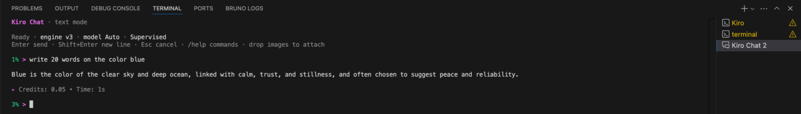

# Terminal chat

[Guide index](README.md) · [Getting started](getting-started.md) · [Chat tabs](chat-tabs.md) · [Terminal chat](terminal-chat.md) · [Slash commands](slash-commands.md) · [Remote access](remote-access.md) · [Reference](reference.md) · [Troubleshooting](troubleshooting.md)

A text-only chat in the Terminal panel, next to your shells. Open it with
**Kiro Chat: New Terminal Chat (text mode)** or the **Kiro Chat** entry in
the Terminal panel's **+** dropdown. Each terminal has its own engine and
conversation, so you can open several.

It streams markdown (colors, lists, code blocks), shows tool cards with diffs
and asks for approvals with kiro-cli's keys: `y` allow, `t` create an allow
rule, `n` deny, Tab deny with a reason, `d` create a deny rule. The rule keys
list the rules to pick by number (exact, pattern, folder, entire tool); Esc
goes back. The prompt shows the context used (`17% >`,
or `17% !>` with Autopilot), and each reply ends with
`▸ Credits: … • Time: …`.

The agent's questions show as numbered choices: type a number or your own
answer, Enter sends (an empty line takes the recommended choice), Esc skips.
`@file:path` in a prompt attaches that file, as in the webview chat.

With remote access on, terminal chats show on the phone as well (see Remote
access).

Type `/` for a menu of commands: it filters as you type, ↑/↓ selects, Tab
completes, Enter runs, Esc hides it. After a command it suggests subcommands
and values (e.g. `/context ` → add/remove/clear/show, `/model ` → models).

Commands follow kiro-cli: `/help`, `/clear`, `/new`, `/chat new|save|load`,
`/resume`, `/rewind`, `/compact`, `/title`, `/transcript`, `/copy`, `/editor`,
`/reply`, `/paste`, `/spawn`, `/context`, `/knowledge`, `/model`, `/effort`,
`/agent` (incl. `create`/`edit`), `/plan`, `/prompts`, `/tools`, `/autopilot`,
`/mcp`, `/hooks`, `/code`, `/config`, `/set`, `/usage`, `/stats`, `/changelog`,
`/settings`, `/theme`, `/restart`, `/login`, `/remote`, `/cls`, `/quit`.

- `/guide`, `/goal` and `/voice` aren't available (the engine or this machine
  can't support them) and say so.
- `/rewind` undoes the agent's file changes after that point, so it asks first.
- `/tools trust-all` and `/tools reset` switch Autopilot on and off (the engine
  only supports trusting all tools at once).
- Unknown slash commands aren't sent to the agent; start the line with a space
  to send `/...` as plain text.

Keys: Enter sends, Shift+Enter adds a new line, Esc cancels a reply, ↑/↓ for
history. While the agent works you can still type: the line shows on the status
line, and Enter sends it to the agent, which reads it at its next step. Esc
first takes back a message the agent hasn't read yet, and the next Esc cancels
the reply. Commands and images wait until the reply is done. Drag image files onto the terminal (or type their paths), or `/paste`
a copied image, to attach them.
